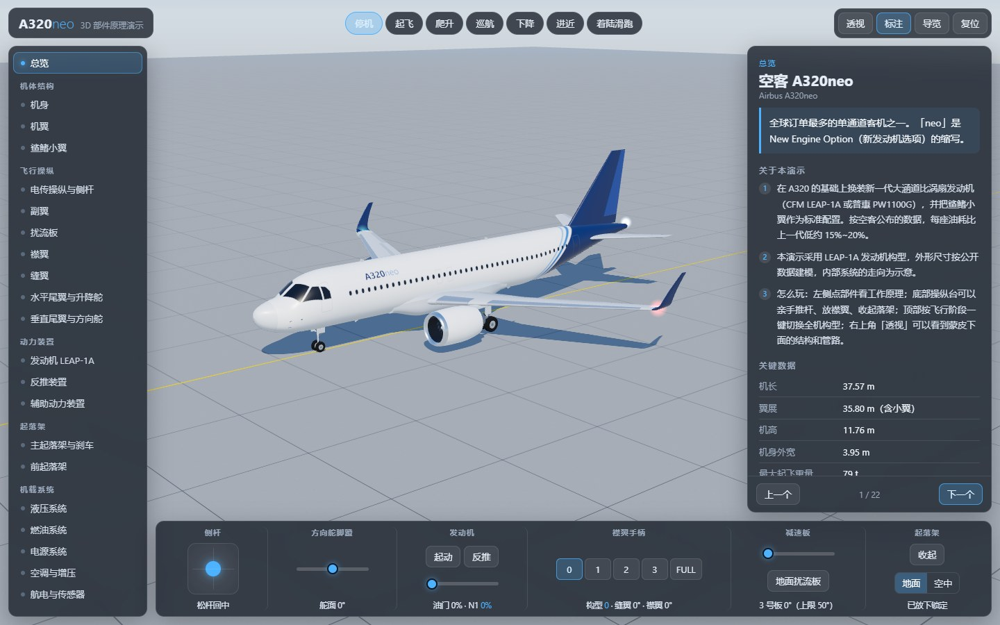
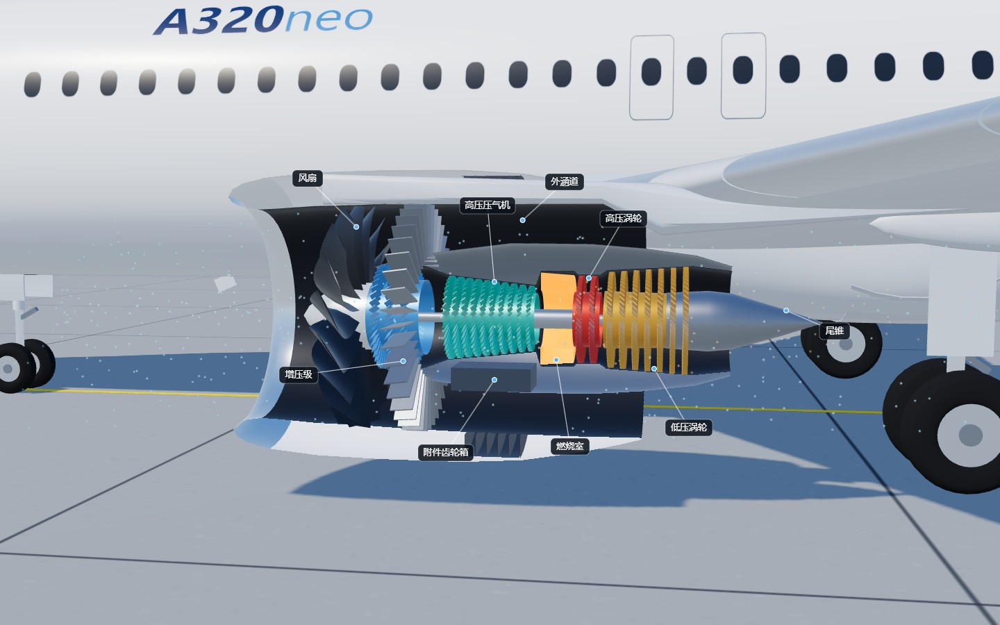
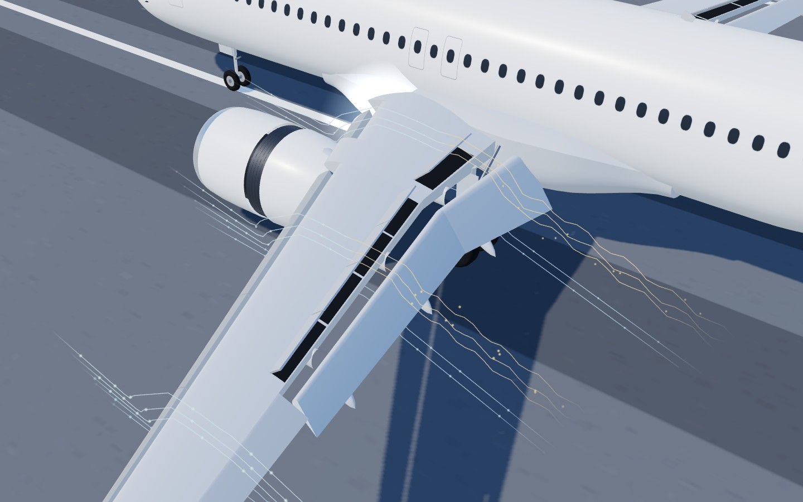
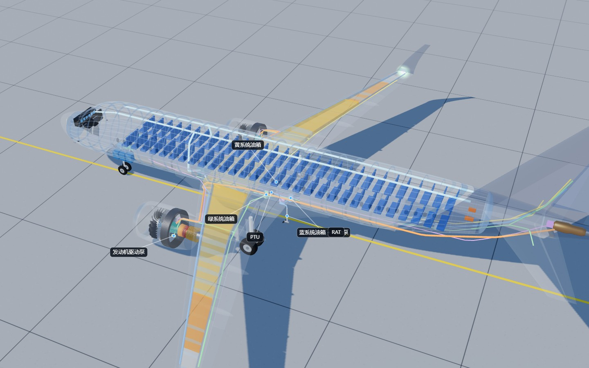
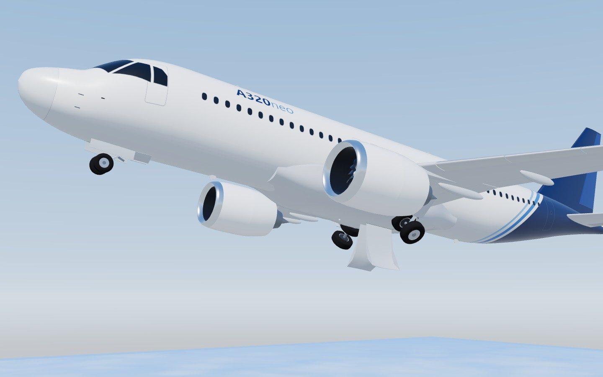

# 空客 A320neo · 3D 部件原理演示

在浏览器里拆开一架空客 A320neo：点任何一个部件看它的工作原理，亲手推杆、放襟翼、收起落架、开反推，或者按飞行阶段一键切换全机构型。

**在线演示：<https://zcube7.github.io/a320neo-3d/>**（电脑、手机浏览器都能用，需要 WebGL 2）



| 发动机剖视（LEAP-1A） | 着陆滑跑：扰流板 + 反推 + 襟翼 |
|---|---|
|  |  |
| **透视：三套液压与 RAT** | **起落架收放过程** |
|  |  |

## 能看到什么

21 个部件，每个都有「一句话作用 + 工作原理 + 关键数据 + 动手试试」：

| 分组 | 部件 |
|---|---|
| 机体结构 | 机身（半硬壳增压舱）、机翼与翼盒、鲨鳍小翼 |
| 飞行操纵 | 电传操纵与侧杆、副翼、扰流板、襟翼、缝翼、水平尾翼与升降舵、垂直尾翼与方向舵 |
| 动力装置 | LEAP-1A 涡扇发动机（剖视）、反推装置、APU |
| 起落架 | 主起落架与刹车、前起落架 |
| 机载系统 | 液压（绿 / 蓝 / 黄 + PTU + RAT）、燃油、电源、空调与增压、航电与传感器、外部灯光 |

会动的东西：

- **舵面**：副翼、5 对扰流板（减速板 / 滚转 / 地面三种用法）、升降舵、可配平水平安定面、方向舵
- **增升装置**：5 段缝翼 + 2 段富勒襟翼，按真实卡位 0 / 1 / 1+F / 2 / 3 / FULL 的角度运动，滑轨整流罩后半截随动
- **发动机**：N1、N2 两根转子按不同转速旋转，内外涵气流粒子（颜色表示温度），反推平移罩后退露出叶栅
- **起落架**：舱门先开 → 支柱收起 → 舱门再关的完整时序，前轮可转弯
- **机翼绕流**：流线随襟缝翼构型变化，扰流板升起后变成橙色的分离流
- **透视模式**：隔框、桁条、座椅、货舱集装箱、油箱、液压 / 电源 / 引气管路、空调组件、电子舱、黑匣子、APU
- **飞行阶段**：停机 → 起飞 → 爬升 → 巡航 → 下降 → 进近 → 着陆滑跑

## 运行

零构建、零 npm 依赖（three.js r180 已放在 `vendor/`）。因为用了 ES 模块，需要通过 HTTP 打开，不能直接双击 `index.html`。

- Windows：双击 `start.cmd`
- 其它：

```bash
node serve.mjs
```

然后打开 <http://127.0.0.1:4191/>。任何静态服务器都可以（例如 `python -m http.server`）。

## 操作

| 操作 | 作用 |
|---|---|
| 拖动 / 滚轮 / 右键拖动 | 旋转 / 缩放 / 平移 |
| 点模型或左侧列表 | 选中部件，相机飞过去 |
| `←` `→` | 上一个 / 下一个部件 |
| `X` | 透视模式 |
| `L` | 标注开关 |
| `T` | 自动导览 |
| `H` | 回到总览 |
| `G` / `F` | 起落架 / 襟翼卡位 |
| `U` | 隐藏界面（截图用） |

### 手机上

| 操作 | 作用 |
|---|---|
| 单指拖动 / 双指捏合 / 双指拖动 | 旋转 / 缩放 / 平移 |
| 点一下模型 | 选中部件 |
| 底部说明条的 `‹` `›` | 上一个 / 下一个部件；点中间展开或收起全文 |
| 底部「部件 / 说明 / 操纵台」 | 三个弹层，同时只开一个 |

弹层打开时飞机会自动挪到没被挡住的那块画面里。竖屏下操纵台是三行两列的网格，六组控件一屏看全；手机横过来时说明变成右侧抽屉，操纵台变成底部一行。

版式按窗口尺寸自动切换：宽度 ≤ 900 px 或高度 ≤ 520 px 用手机版式，其余用桌面三栏。

链接可以带初始状态，方便分享某个画面：

```
?part=engine&set=throttle:0.85          发动机剖视，油门 85%
?part=flap&set=flap:4,airborne:1        空中、襟翼 FULL
?phase=rollout&part=spoiler             着陆滑跑时看扰流板
```

`part` 取部件 id（见 `js/content_a.js`、`js/content_b.js`），`phase` 取 `park / takeoff / climb / cruise / descent / approach / rollout`。

## 数据来源与简化

**按公开数据取值的**：机长 37.57 m、翼展 35.80 m、机高 11.76 m、机身截面 3.95 × 4.14 m、轮距 12.64 / 7.59 m、后掠角 25°、LEAP-1A 风扇直径 1.98 m 及级数（1 + 3 + 10 / 2 + 7）、涵道比、襟缝翼各卡位角度、各舵面偏转极限、液压 / 电源 / 燃油系统的主要参数。

主要参考：

- [Airbus A320neo family（Wikipedia）](https://en.wikipedia.org/wiki/Airbus_A320neo_family)
- [Airbus A320 family（Wikipedia）](https://en.wikipedia.org/wiki/Airbus_A320_family)
- [CFM International LEAP（Wikipedia）](https://en.wikipedia.org/wiki/CFM_International_LEAP)
- 襟缝翼与舵面角度另外对照了公开流传的 A320 飞行控制资料（[AviationHunt](https://www.aviationhunt.com/a320-flaps-lever/)、[SmartCockpit](https://www.smartcockpit.com/wp_quiz/airbus-a320-flight-controls/) 等）

**做了简化的地方**（这是科普演示，不是工程模型）：

- 外形是按上面的尺寸用程序手工拟合出来的，机身截面、翼型、短舱型线都是近似
- 侧杆直接映射成舵面角度；真机上舵面怎么动由飞控计算机按控制律决定。空中的滚转 / 俯仰响应只是示意，没有飞行力学仿真
- 发动机转速大幅放慢以便观察；除风扇 18 片外，各级叶片数为示意
- 液压、电源、引气管路的走向是按大致布置画的示意，不是逐根管线的复刻
- 襟翼 FULL 取 35°（部分发动机构型为 40°）；燃油容量取标准构型的约数
- 涂装是虚构的，不代表任何航空公司

## 目录

```
index.html            页面骨架
css/style.css         界面样式（桌面三栏 + 手机竖屏 / 横屏两套紧凑版式）
js/main.js            入口：状态、每帧更新、取景、拾取与高亮
js/ui.js              部件列表、说明面板、操纵台、标注、手机弹层
js/layout.js          版式判定，以及"没被面板挡住的空白区域"的计算
js/content_a.js       讲解文案（上）：总览、机体结构、飞行操纵
js/content_b.js       讲解文案（下）：动力装置、起落架、机载系统
js/specs.js           机型数据 + 舵面混合逻辑 + 起落架时序（纯函数，可在 Node 里测）
js/aircraft.js        整机装配
js/fuselage.js        机身外形与涂装贴图
js/surface.js         升力面参数化（机翼 / 尾翼共用）
js/wing.js            机翼、缝翼、襟翼、副翼、扰流板、小翼
js/tail.js            垂尾、方向舵、水平安定面、升降舵
js/engine.js          LEAP-1A 短舱与双转子内部
js/gear.js            起落架与舱门
js/systems.js         机内结构、设备、探头、RAT、灯光
js/plumbing.js        液压 / 电源 / 引气管路
js/flow.js            发动机气流与机翼绕流粒子
js/env.js             天空、地面、云层、光照
js/orbit.js           轨道相机
js/geom.js            放样、折痕法线、翼型、铰链等几何工具
tests/specs.test.mjs  单元测试
vendor/               three.js r180（MIT）
```

## 测试

```bash
node --test tests/specs.test.mjs
```

覆盖操纵面混合逻辑（副翼反向、滚转扰流板只在下沉侧、减速板对称、行程限幅）、襟缝翼构型表、起落架舱门时序、飞行阶段预设和讲解内容的完整性。

## 许可

代码以 MIT 许可发布，见 [LICENSE](LICENSE)。three.js 的许可见 [vendor/LICENSE](vendor/LICENSE)。

Airbus、A320neo、CFM、LEAP 等名称是各自所有者的商标。本项目是非官方的科普演示，与上述公司没有关联，内容不能用作飞行训练、维修或任何工程用途的依据。
